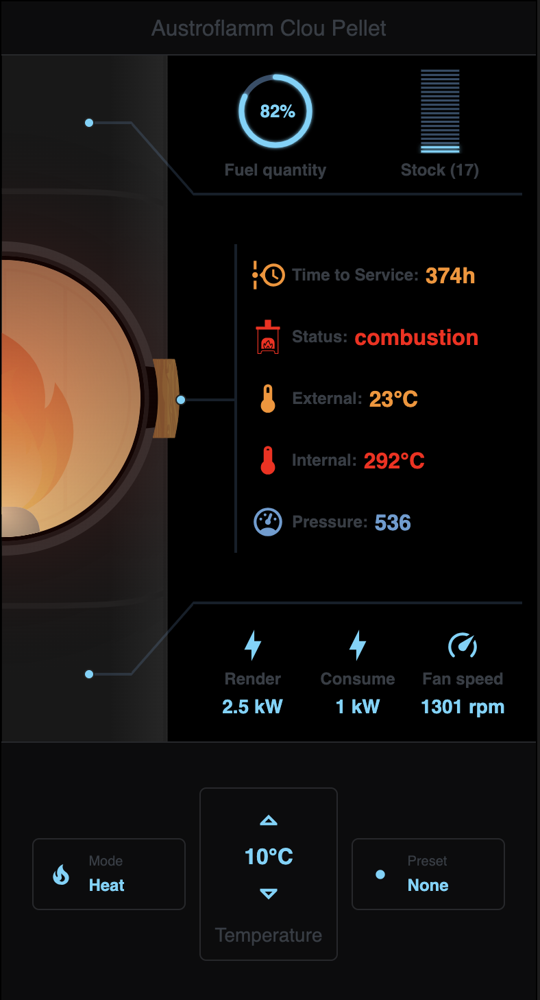
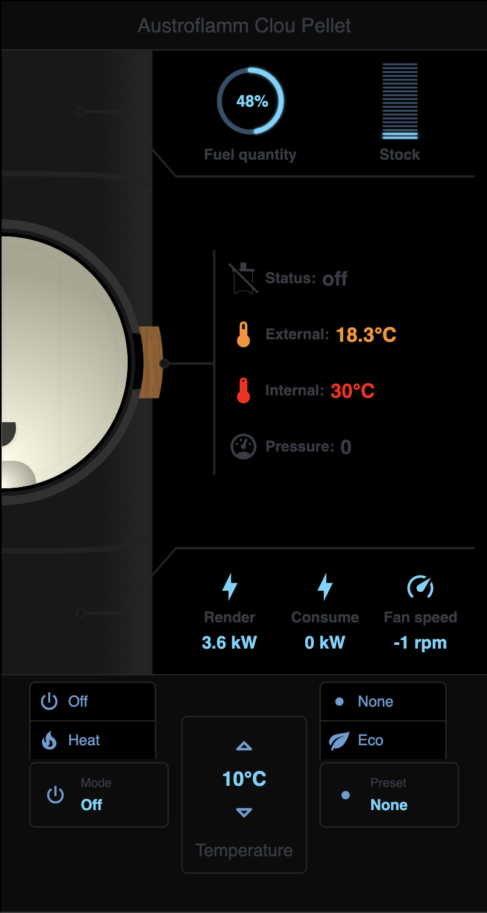
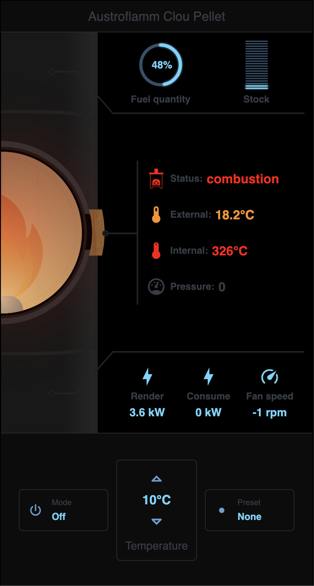

# 🪵🔥 Stove card

**`custom:sci-fi-stove`** — Dedicated card for a pellet stove.

> [!NOTE]
> Based on [fumis integration](https://github.com/maheus/fumis_integration) by [maheus](https://github.com/maheus).

---

## Features

- Graphical stove state (cool / heat / off)
- Internal pellet quantity + optional storage counter with alert thresholds
- Sensor display: state, pressure, time to service, temperatures, power, fan speed
- Actions: HVAC mode, target temperature, preset
- Optional collapsible "Wear" section (collapsed by default): heating time, fuel used, igniter starts, misfires, overheatings — a configured counter that cannot be read shows `—`

---

## Screenshots

<details>
<summary>Show</summary>





</details>

---

## Configuration

> [!TIP]
> This card can be configured through the HA UI editor.

### Minimal

```yaml
type: custom:sci-fi-stove
entity: climate.my_stove
```

### Full

```yaml
type: custom:sci-fi-stove
entity: climate.my_stove
sensors:
  sensor_actual_power: sensor.stove_actual_power
  sensor_power: sensor.stove_power
  sensor_combustion_chamber_temperature: sensor.stove_combustion_temp
  sensor_inside_temperature: sensor.stove_room_temp
  sensor_pellet_quantity: sensor.stove_pellet_quantity
  sensor_status: binary_sensor.stove_status
  sensor_fan_speed: sensor.stove_fan_speed
  sensor_pressure: sensor.stove_pressure
  sensor_time_to_service: sensor.stove_time_to_service
  sensor_heating_time: sensor.stove_heating_time
  sensor_fuel_used: sensor.stove_fuel_used
  sensor_igniter_starts: sensor.stove_igniter_starts
  sensor_misfires: sensor.stove_misfires
  sensor_overheatings: sensor.stove_overheatings
pellet_quantity_threshold: 0.1
storage_counter: counter.pellet_stock
storage_counter_threshold: 0.1
pellet_cost: input_number.pellet_cost
```

### Options

| Name | Type | Required | Description | Default |
|---|---|---|---|---|
| `type` | String | ✅ | `custom:sci-fi-stove` | |
| `entity` | String | ✅ | Stove `climate` entity ID | |
| `sensors` | Object | | Additional stove sensors | |
| `pellet_quantity_threshold` | Float | | Internal pellet alert threshold (0–1) | `0.1` |
| `storage_counter` | String | | Pellet bag counter entity | |
| `storage_counter_threshold` | Float | | Storage counter alert threshold (0–1) | `0.1` |
| `pellet_cost` | String | | Numeric entity holding the pellet cost (e.g. an `input_number`), shown next to the stock | |

### `sensors` options

| Name | Type | Description |
|---|---|---|
| `sensor_actual_power` | String | Rendered power sensor |
| `sensor_power` | String | Power consumption sensor |
| `sensor_combustion_chamber_temperature` | String | Combustion chamber temp |
| `sensor_inside_temperature` | String | Room temperature |
| `sensor_pellet_quantity` | String | Internal pellet level — a percentage (0–100) or a ratio (0–1: a value ≤ 1 is read ×100), as the bridge reads it |
| `sensor_status` | String | `binary_sensor` state |
| `sensor_fan_speed` | String | Fan speed sensor |
| `sensor_pressure` | String | Pressure sensor |
| `sensor_time_to_service` | String | Time to service sensor |
| `sensor_heating_time` | String | Wear counter: total heating time (`sensor.*`) |
| `sensor_fuel_used` | String | Wear counter: fuel used (`sensor.*`) |
| `sensor_igniter_starts` | String | Wear counter: igniter starts (`sensor.*`) |
| `sensor_misfires` | String | Wear counter: misfires (`sensor.*`) |
| `sensor_overheatings` | String | Wear counter: overheatings (`sensor.*`) |

---

## Pellet storage counter automation

Auto-decrement your counter when the stove is refilled:

```yaml
alias: Pellet stock management
triggers:
  - trigger: numeric_state
    entity_id: sensor.stove_pellet_quantity
    above: 99
    for: "00:02:00"
conditions:
  - condition: template
    value_template: "{{ trigger.from_state.state | is_number }}"
actions:
  - action: counter.decrement
    target:
      entity_id: counter.pellet_stock
mode: single
```

The trigger fires when the level crosses 99 and stays there for two minutes; the
condition skips a return from `unavailable` or `unknown`, which would otherwise
decrement a bag that was never loaded.

---

## Pellet cost

The card shows the state of the entity set in `pellet_cost`, next to the stock —
for example `Cost (26.00 €)`. It computes nothing: Home Assistant keeps the amount
up to date with two helpers and one automation.

### Helpers

Create both in Settings → Devices & services → Helpers → Number:

| Helper | Settings |
|---|---|
| `input_number.pellet_bag_price` | price of one bag, step 0.01, unit of measurement `€` |
| `input_number.pellet_cost` | min 0, max 100000, step 0.01, **unit of measurement `€`** — without a unit, the card shows the amount alone |

### Cost automation

Each drop of `counter.pellet_stock` adds `bags removed × bag price` to the cost:

```yaml
alias: Pellet cost
triggers:
  - trigger: state
    entity_id: counter.pellet_stock
    not_from: [unavailable, unknown]
    not_to: [unavailable, unknown]
conditions:
  - condition: template
    value_template: >
      {{ trigger.from_state.state | is_number
         and trigger.to_state.state | is_number
         and trigger.from_state.state | int > trigger.to_state.state | int }}
actions:
  - variables:
      bags: "{{ trigger.from_state.state | int - trigger.to_state.state | int }}"
  - action: input_number.set_value
    target:
      entity_id: input_number.pellet_cost
    data:
      value: >
        {{ states('input_number.pellet_cost') | float(0)
           + bags * states('input_number.pellet_bag_price') | float(0) }}
mode: queued
```

`mode: queued` keeps two close drops from losing an update.

### Notes

- **Price change** — the cost is booked at the price in force when the stock drops;
  changing the bag price only affects bags consumed afterwards.
- **Manual correction** — any downward change of `counter.pellet_stock` is billed, a
  manual correction included: turn the `Pellet cost` automation off before correcting
  the stock, then back on. An increase (a restock) costs nothing.
- **Season or total** — the card shows one entity. For a cost per season, October to
  October (recommended), create a second helper `input_number.pellet_cost_season`
  with the same settings and point `pellet_cost` at it. Keep the automation above as
  it is and add this action at the end of its `actions`:

  ```yaml
    - action: input_number.set_value
      target:
        entity_id: input_number.pellet_cost_season
      data:
        value: >
          {{ states('input_number.pellet_cost_season') | float(0)
             + bags * states('input_number.pellet_bag_price') | float(0) }}
  ```

  Then reset the season every October 1st:

  ```yaml
  alias: Pellet cost new season
  triggers:
    - trigger: time
      at: "00:00:00"
  conditions:
    - condition: template
      value_template: "{{ now().month == 10 and now().day == 1 }}"
  actions:
    - action: input_number.set_value
      target:
        entity_id: input_number.pellet_cost_season
      data:
        value: 0
  mode: single
  ```

### Troubleshooting

- No cost cell on the card: check the entity id in Developer tools → States, and that
  its state is a number below 1e9 (`unavailable`, `unknown` or text hide the cell).
